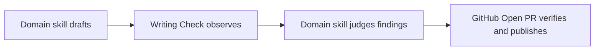

# PR Description

## Purpose

Help an unfamiliar reviewer understand the final change with the fewest useful words. This skill owns the reviewer journey, behavioral before/after, and developer-centered evidence; the calling workflow owns every Git or GitHub mutation. Vale and readability never replace this semantic contract.

## Happy path

1. Select **Draft**, **Improve**, or **Audit**. Establish base and head, then read the complete final range and diff, linked issue/design context, repository instructions, and observed validation. For an existing PR, also verify its title, body, scope-changing comments, files, and patch.
2. Treat commits and existing copy as claims, not truth. Do not invent intent, impact, risk, results, rollout state, issue links, or metrics. Ask for author context when it materially changes the body.
3. Draft or improve the required contract below. Keep it proportional: usually under 120 words for a local obvious change, 300 for medium behavior/workflow work, and 500 for cross-system or migration work. These are ceilings, not targets.
4. Run Writing Check on the exact final candidate and separately verify this skill’s semantic duties. Return the body (or audit), not a Git/GitHub mutation.

## Required public body

Every ready-to-paste Draft or Improve body uses these exact headings in this order:

```markdown
## Why
## What changed
## Evidence
```

**Why** states the verified pre-change problem, why work was needed, and its important user or system consequence. Lead with behavior, not a title repeat or inventory.

**What changed** explains the behavioral before/after by concept, not file or commit. For a multi-component behavior, include the smallest useful happy path and one concrete example if it clarifies input, output, migration, failure, or authority. When a large flow would interrupt the path, use one collapsed `<details>` block and at most one eight-node GitHub-native Mermaid diagram; pair it with the example and omit it when prose is clearer. Do not add architecture decoration or a second review-guide surface.

Explain material new or stricter preconditions on a write, install, or apply: which input or layout class is refused and what remains unchanged on failure. Use a compact boundary statement when it affects compatibility or recovery; do not enumerate internal checks or add failure boilerplate to unrelated changes.

````markdown
<details>
<summary>Happy path example</summary>



A required qualifier can remain even when Vale flags it; the final source is checked again before publication.

</details>
````

**Evidence** connects each materially different claim to (1) observed validation or outcome, (2) the behavior or boundary exercised, and (3) why a developer or reviewer should care. Use a short bold headline with one or two indented bullets only when one sentence would be dense. Aggregate checks supporting the same claim; do not dump commands, check names, Harness Kit records, agents, bot status, or repetitive disclaimers. Add a remaining-gap note only when it prevents a likely overclaim.

```markdown
- **Broken checks cannot look clean.**
  - Missing Vale and malformed output produce explicit unavailable and execution-error records while retaining source identity.
  - Authors will not mistake a broken checker for clean writing evidence.
```

After the required sections, add `Decision needed`, `Migration`, or `Rollout` only for real unresolved choices, obligations, or rollout behavior. Do not add empty headings or generic reviewer questions.

Whenever a change summary or file inventory is included, give each conceptual change group and each individual file entry, including supporting files, a TL;DR of at most one short sentence. Explain the group's behavioral change or purpose and the file's actual change from the diff; do not merely paraphrase its label or filename or repeat the surrounding prose.

For helper-generated tables, add these owner-authored TL;DRs after `<br>` in the existing `Conceptual group` summary cells and individual `File` cells, escaping table delimiters. Keep mechanically sourced paths, classifications, group membership, counts, and columns unchanged; do not repeat group TL;DRs in file rows or add them to subtotal/total rows. The helper supplies mechanics, not semantic descriptions. Do not force a table for a trivial PR that otherwise permits simpler prose or a list.

## Large-diff composition

For strictly more than 500 Git textual changed-line events, run the helper against the exact base and head through the repository-owned Python environment:

```bash
python3 <skill-dir>/scripts/pr_change_shape.py BASE HEAD --repo REPO
```

This threshold affects only optional `What changed` composition; it never affects activation, headings, semantic evidence, or Writing Check. After assigning every core path to at most five change-specific conceptual groups, render Markdown with:

```bash
python3 <skill-dir>/scripts/pr_change_shape.py BASE HEAD --repo REPO \
  --markdown --groups-json /tmp/pr-change-groups.json
```

The helper disables external diff/text conversion, parses NUL-delimited raw and numstat records, queries tree-specific attributes, and reports exact additions/deletions. It classifies `core` or folded `supporting` work (tests, fixtures, docs, config, manifests, lockfiles, generated/vendored material, and similar artifacts). It does not invent conceptual groups.

Put its summary in `What changed`: totals, core conceptual groups, one folded supporting category, and the statement that additions + deletions describe diff shape; modified lines can count twice; they are not effort, risk, quality, review time, or readiness. Keep binary/submodule changes visible without invented counts. Exactly 500 does not trigger the table, though composition can justify it earlier. Beneath it, include collapsed **Core changes** and **Supporting changes** inventories: every mechanically sourced core file grouped with additions, deletions, events, and subtotals; supporting totals by kind plus every supporting file, kind, counts, and subtotals. Never invent a path, move supporting work for narrative balance, or substitute tables for behavioral explanation.

## Writing Check dependency

This skill invokes the independently distributed `writing-check-cli` package. If the CLI is missing, request explicit install consent. With consent and `uv`, run `uv tool install writing-check-cli==1.0.0` (published on PyPI), then `writing-check --help`. As an optional source fallback, with authenticated `gh` access to the private `alex-furrier/skills` repository, set `checkout="$(mktemp -d)"`, run `gh repo clone alex-furrier/skills "$checkout/skills"`, inspect and trust the checkout, then run `uv tool install "$checkout/skills/packages/writing-check"` and `writing-check --help`. From an existing trusted checkout, `uv tool install ./packages/writing-check` works. Never install automatically. If `uv`, network, install, or help fails (or `gh` or access fails on the source route), report the check unavailable rather than claiming it ran. If the command is missing or returns `unavailable` or `execution_error`, report that advisory check as unavailable and do not substitute another linter.

## Preserve and check the final candidate

In Improve mode, retain accurate, specific, useful human wording where practical while reorganizing under the required contract. Change it only for a factual mismatch, missing critical context, weak hierarchy, duplication, synthetic prose, stale evidence, or contract compliance. Keep required text, closing lines, links, credits, checklists, disclosures, and author uncertainty. Never rewrite inside machine-managed marker blocks; the mutation owner merges them byte-for-byte and stops when ownership/placement is unclear.

Preserve the meaning, qualifications, warnings, and safety, authentication, authority, factual, and contractual constraints of the body. Keep required headings, machine-consumed syntax, and owner-marked required text intact; other prose may be revised under the Improve contract. A checker suggestion alone never authorizes a factual or constraint-changing edit.

After semantic drafting and each revision, run `writing-check --profile pr-description` on the exact candidate. Confirm its retained text and `source.sha256` match the bytes handed to the mutation owner. The reviewed Google Vale v0.7.1 rules exclude upstream word-list substitutions; findings are advisory review items. In Draft/Improve, fix or explicitly disposition each one against this exact digest. Readability is private and advisory: insufficient below 100 prose words or 5 sentences, small below 200 or 8, normal at 200 and 8 with FRE 55 / FK 10 observations. A destination owner may retain exact terms, quotes, required text, or voice. Complete disposition accounting is never a quality, readiness, or publication gate.

Report `input_error`, `unavailable`, or `execution_error` explicitly; never call them clean or claim a checker ran when unavailable. If the candidate or managed block changes, discard stale evidence and rerun. For a normal sample outside the advisory targets, make at most three focused passes, preserving all protected text and never gaming formulas or expanding familiar terms. After three misses, report final metrics, attempted improvements, and residual dense sections. A clean record still does not prove headings, behavioral explanation, or evidence quality.

## Return

For Draft, return the body and a private note only for unresolved author facts or required text. For Improve, return `No body change needed` only when the existing body already satisfies the exact headings and semantic contract and has a current usable final-candidate record; otherwise return `Apply revision: reason`. Exclude that decision from public copy. For Audit, load [the rubric](references/rubric.md), cite evidence, and name the few highest-value fixes without rewriting.
